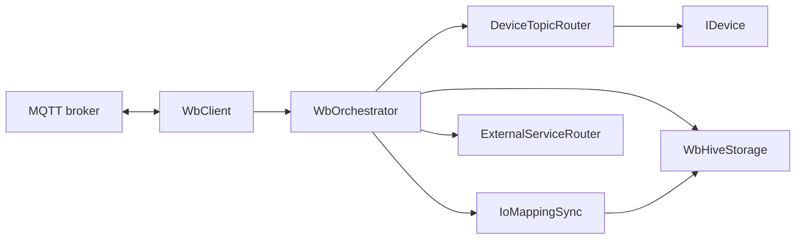

# wb_sdk

Dart-библиотека для написания виртуальных устройств и драйверов под [Wiren Board](https://wirenboard.com/) MQTT. Реализует [конвенции топиков Wiren Board](https://github.com/wirenboard/conventions), оркестрацию подписок и публикаций, хранение retain-значений и маппинг `io_mapping`.

Пакет рассчитан на использование вместе с генератором кода [`wb_generate`](https://github.com/AndreiLosev/wb-generate) (аннотации `@VirtualDevice`, `@InputControl`, `@OutputControl`), но устройства можно собирать и вручную через [IDevice](lib/contracts/idevice.dart).

## Возможности

- **Оркестратор** — маршрутизация MQTT-сообщений к устройствам, bootstrap (meta, retain, подписки), остановка клиента.
- **Устройства** — модель `IDevice` / `PartOfIDevice` с входами, выходами, метаданными контролов и зависимостями.
- **MQTT** — клиент поверх `mqtt_client`, публикация с учётом алиасов топиков.
- **Хранилище** — персистентность через Hive CE (retain, `io_mapping`).
- **Маппинг I/O** — синхронизация `io_mapping/inputs|outputs` с локальным storage.
- **Внешние сервисы** — `IExternalService` с собственным MQTT-префиксом.
- **Кодеки и meta** — сериализация payload и JSON для `/meta` топиков.
- **Управление** — PID-регулятор, триггеры, отладочный лог в `debug/{device}`.

## Требования

- Dart SDK **^3.13.0**

## Установка

Зависимость в `pubspec.yaml` приложения-драйвера:

```yaml
dependencies:
  wb_sdk:
    git:
      url: git@github.com:AndreiLosev/wb-sdk.git
```

Локальная разработка (монорепозиторий):

```yaml
dependencies:
  wb_sdk:
    path: ../wb-sdk
```

```bash
dart pub get
```

## Быстрый старт

### 1. Сборка оркестратора

`WbOrchestratorBuilder` подключается к брокеру, открывает Hive и возвращает готовый `WbOrchestrator`:

```dart
import 'package:wb_sdk/wb_sdk.dart';

Future<void> main() async {
  final builder = WbOrchestratorBuilder(
    mqttHost: 'localhost',
    mqttPort: 1883,
    mqttClientId: 'my-driver-1',
    storageDirectory: '/var/lib/wb-driver',
  );

  final orchestrator = await builder.build(
    devices: [/* ваши IDevice */],
    services: [/* опционально IExternalService */],
  );

  await orchestrator.run();
}
```

Для тестов и кастомного окружения можно собрать оркестратор без I/O:

```dart
final orchestrator = WbOrchestrator.assemble(
  mqtt: myMqttClient,
  devices: devices,
  storage: optionalStorage,
);
orchestrator.prepare();
```

### 2. Минимальное устройство (без генератора)

Устройство объявляет части (`PartOfIDevice`), регистрирует их в конструкторе и реализует `execute()`:

```dart
class MyDevice extends IDevice {
  MyDevice() {
    register(_MyDevicePart());
  }

  @override
  String get name => 'my_device';

  @override
  void execute([String? topic]) {
    // логика по событию MQTT
  }
}
```

Входящее сообщение на `{name}/{control}/on` вызывает `updateField`, затем `execute`; исходящие топики обновляют только поля.

### 3. Публикация из кода устройства

После `prepare()` / `run()` доступны глобальные хелперы оркестратора:

```dart
wbPublish('my_device/lamp', '1');
final dev = getDevice<MyDevice>('my_device');
```

### 4. Аннотации и генерация

Аннотации в `wb_sdk` описывают контролы в терминах Wiren Board. Генератор `wb_generate` по ним создаёт классы устройств, meta и обработчики полей. Пример объявления (в исходниках, обрабатываемых build_runner):

```dart
@VirtualDevice(dependencies: ['sensors/temp'])
class ClimateDriver extends IDevice { ... }

@InputControl(type: WbControlType.value, title: WbLocalizedTitle(en: 'Temperature'))
double roomTemp = 0;

@OutputControl(type: WbControlType.switchControl)
bool fan = false;
```

## Архитектура



При старте `OrchestratorBootstrap`:

1. публикует meta устройств и контролов;
2. подписывается на топики устройств, `io_mapping`, debug, внешние сервисы;
3. восстанавливает retain из storage;
4. вызывает начальный `execute()` у каждого устройства.

## Структура пакета

| Путь | Назначение |
|------|------------|
| `lib/annotations/` | `@VirtualDevice`, `@InputControl`, `@OutputControl`, `@Retain` |
| `lib/contracts/` | `IDevice`, `WbMqttClient`, `WbStorage`, `IExternalService` |
| `lib/orchestrator/` | `WbOrchestrator`, builder, маршрутизация |
| `lib/mqtt/` | клиент, топики, маппинг |
| `lib/storage/` | Hive-реализация storage |
| `lib/control/` | PID, триггеры |
| `lib/coder.dart`, `lib/wb_meta_json.dart` | кодирование значений и meta JSON |
| `lib/helpers.dart` | `makeExternalDependencies`, разбор топиков |

Публичный API экспортируется из [`lib/wb_sdk.dart`](lib/wb_sdk.dart).

## Тесты

```bash
dart test
```

В тестах используются фейковый MQTT-клиент и `WbOrchestrator.assemble` / `handleMessage` без реального брокера.

## Связанные проекты

- [wirenboard/conventions](https://github.com/wirenboard/conventions) — соглашения по MQTT-топикам
- [`wb_generate`](https://github.com/AndreiLosev/wb-generate) — генератор устройств на аннотациях `wb_sdk`

## Лицензия

Уточняется владельцем репозитория; файл LICENSE пока не добавлен.